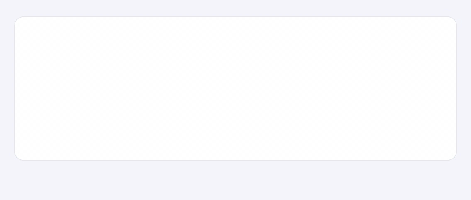

# build-reveal

Make your page look like it is being built live in a design tool. Virtual cursors fly in, drag a selection frame around each element, fade it in and type its text.

<p align="center">
  
</p>

<p align="center">
  <a href="https://hayrullah-zafer-yilmaz.github.io/build-reveal/">Live demo</a> ·
  <a href="docs/README.tr.md">Türkçe</a> ·
  <a href="docs/README.md">Documentation</a> ·
  <a href="CHANGELOG.md">Changelog</a>
</p>

- **Works with any stack**: a dependency-free core, React and Vue components, and a `<build-reveal>` element for Angular, Svelte or plain HTML.
- **One attribute**: add `data-build` to what should appear. Nothing to configure.
- **Unobtrusive**: plays when the content is in view, waits while something covers it, and stops as soon as the user interacts.
- **Accessible**: respects `prefers-reduced-motion`, never leaves content hidden, and can be switched off globally.
- **Guided tours**: the same cursor can walk users through your real interface, step by step.
- **Small**: about 8 KB gzipped for the reveal and 10 KB for tours, with no dependencies.

## Install

```bash
npm install build-reveal
```

Or load it from a CDN, without a build step:

```html
<script src="https://unpkg.com/build-reveal@0.2"></script>
```

## Quick start

Put your content in a container, the *stage*, and mark the elements that should appear:

| Markup | Effect |
| --- | --- |
| `data-build` | The element is framed and faded in. |
| `data-build="type"` | Same, and its text is typed in. |

Then pick your setup.

**HTML**, with the script tag above. The element registers itself:

```html
<build-reveal>
  <h1 data-build="type">Revenue</h1>
  <p data-build>Up 12% this month.</p>
</build-reveal>
```

**JavaScript**

```js
import { createBuildReveal } from 'build-reveal';

createBuildReveal(document.querySelector('#hero'));
```

**React**

```tsx
import { BuildReveal } from 'build-reveal/react';

export function Hero() {
  return (
    <BuildReveal>
      <h1 data-build="type">Revenue</h1>
      <p data-build>Up 12% this month.</p>
    </BuildReveal>
  );
}
```

**Vue**

```vue
<script setup>
import { BuildReveal } from 'build-reveal/vue';
</script>

<template>
  <BuildReveal>
    <h1 data-build="type">Revenue</h1>
    <p data-build>Up 12% this month.</p>
  </BuildReveal>
</template>
```

**Angular, Svelte and others**: see the [Angular](docs/frameworks/angular.md), [Svelte](docs/frameworks/svelte.md) or [Web Component](docs/frameworks/web-component.md) guide.

That's it: the animation plays when the stage scrolls into view.

## Options

| Option | Default | |
| --- | --- | --- |
| `cursors` | `3` | Number of cursors, or a list like `[{ label: 'Ada', color: '#0ea5e9' }]`. |
| `speed` | `1` | Playback speed: `2` is twice as fast. |
| `trigger` | `'visible'` | `'visible'` plays when the stage scrolls into view; `'manual'` waits for `play()`. |
| `progressive` | `false` | Reveal each element as it scrolls into view. For long pages. |
| `hold` | `false` | Keep the animation open while content is loading. |
| `disabled` | `false` | Skip the animation and show everything. |
| `onComplete` | | Called when the animation finishes or is cut short. |

You can also control a reveal: `play()` replays it, `finish()` ends it, `update(options)` changes options and `destroy()` removes it. See the [API reference](docs/api.md).

## How it behaves

- **Starts** when at least 30% of the stage is visible (or it fills half the screen) and nothing, such as a cookie banner, covers it. It waits at most 4 seconds for that.
- **Stops** and shows everything as soon as the user clicks, taps, presses a key, moves focus into the stage or scrolls the stage out of view. Scrolling on a touch screen doesn't stop it.
- **Skips** the animation if the user prefers reduced motion. Nothing is hidden then.

## Guided tours

The same cursor can show users around your real interface. It frames each element, explains it in a caption, and acts out a click or typing without touching your app:

```js
import { createTour } from 'build-reveal/tour';

const tour = createTour([
  { target: '#search', caption: 'Type the invoice you are looking for.', type: 'Invoice 2026' },
  { target: '#filter', caption: 'Filter the list by date.', click: true },
  { target: '#export', caption: 'Download it as a spreadsheet.' }
]);

tour.start();
```

Users move through it with Next, Back and Close, or the keyboard. See [Guided tours](docs/tour.md).

## Documentation

- [Getting started](docs/getting-started.md)
- [Marking content](docs/markup.md)
- [Guided tours](docs/tour.md)
- Frameworks: [JavaScript](docs/frameworks/vanilla.md) · [Web Component](docs/frameworks/web-component.md) · [React & Next.js](docs/frameworks/react.md) · [Vue & Nuxt](docs/frameworks/vue.md) · [Angular](docs/frameworks/angular.md) · [Svelte](docs/frameworks/svelte.md)
- [API reference](docs/api.md)
- [Theming](docs/theming.md)
- [Accessibility](docs/accessibility.md)
- [FAQ & troubleshooting](docs/faq.md)

## Browser support

Current Chrome, Edge, Firefox and Safari (16.4 and later). Text is typed with the [CSS Custom Highlight API](https://developer.mozilla.org/docs/Web/API/CSS_Custom_Highlight_API); in browsers without it, typed elements fade in instead.

## Development

```bash
npm install
npm run dev            # demo of every integration at http://localhost:5173
npm test               # unit tests
npm run typecheck
npm run build          # builds the package into dist/
npm run check:package  # loads the built package the way users do
```

## License

[MIT](LICENSE) © Hayrullah Zafer Yılmaz
