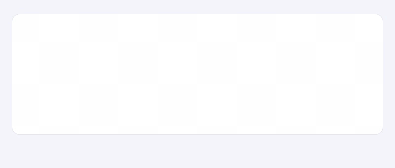

# build-reveal

Sayfanız bir tasarım aracında canlı olarak hazırlanıyormuş gibi görünsün. Sanal imleçler ekrana gelir, her öğenin etrafına bir seçim çerçevesi çizer, öğeyi görünür hale getirir ve metnini harf harf yazar.

<p align="center">
  
</p>

<p align="center">
  <a href="https://hayrullah-zafer-yilmaz.github.io/build-reveal/">Canlı demo</a> ·
  <a href="../README.md">English</a> ·
  <a href="README.md">Dokümantasyon (İngilizce)</a> ·
  <a href="../CHANGELOG.md">Değişiklikler</a>
</p>

- **Her projede çalışır**: bağımlılığı olmayan bir çekirdek, React ve Vue bileşenleri, Angular, Svelte ya da düz HTML için `<build-reveal>` elementi.
- **Tek attribute**: görünmesini istediğiniz öğelere `data-build` eklemeniz yeterli. Ayar gerekmez.
- **Araya girmez**: içerik ekrana girince oynar, üstü kapalıysa bekler, kullanıcı etkileşime geçtiği anda durur.
- **Erişilebilir**: sistemdeki "hareketi azalt" ayarına uyar, içeriği hiçbir zaman gizli bırakmaz ve tek satırla tamamen kapatılabilir.
- **Küçük**: tek script olarak yaklaşık 9 KB (gzip).

## Kurulum

```bash
npm install build-reveal
```

Ya da build adımı olmadan CDN'den yükleyin:

```html
<script src="https://unpkg.com/build-reveal@0.1"></script>
```

## Hızlı başlangıç

İçeriğinizi bir kapsayıcının (*stage*) içine koyun ve görünmesini istediğiniz öğeleri işaretleyin:

| İşaret | Etkisi |
| --- | --- |
| `data-build` | Öğenin etrafına çerçeve çizilir, ardından öğe görünür hale gelir. |
| `data-build="type"` | Aynısı, ayrıca metni harf harf yazılır. |

Sonra kullandığınız ortama uygun olanı seçin.

**HTML** (yukarıdaki script etiketiyle). Element kendini otomatik kaydeder:

```html
<build-reveal>
  <h1 data-build="type">Gelir</h1>
  <p data-build>Bu ay %12 arttı.</p>
</build-reveal>
```

**JavaScript**

```js
import { createBuildReveal } from 'build-reveal';

createBuildReveal(document.querySelector('#hero'));
```

**React**

```tsx
import { BuildReveal } from 'build-reveal/react';

export function Hero() {
  return (
    <BuildReveal>
      <h1 data-build="type">Gelir</h1>
      <p data-build>Bu ay %12 arttı.</p>
    </BuildReveal>
  );
}
```

**Vue**

```vue
<script setup>
import { BuildReveal } from 'build-reveal/vue';
</script>

<template>
  <BuildReveal>
    <h1 data-build="type">Gelir</h1>
    <p data-build>Bu ay %12 arttı.</p>
  </BuildReveal>
</template>
```

**Angular, Svelte ve diğerleri**: [Angular](frameworks/angular.md), [Svelte](frameworks/svelte.md) ya da [Web Component](frameworks/web-component.md) rehberine bakın.

Bu kadar: stage ekrana girdiğinde animasyon oynar.

## Seçenekler

| Seçenek | Varsayılan | |
| --- | --- | --- |
| `cursors` | `3` | İmleç sayısı ya da `[{ label: 'Ada', color: '#0ea5e9' }]` gibi bir liste. |
| `speed` | `1` | Oynatma hızı: `2` iki kat hızlıdır. |
| `trigger` | `'visible'` | `'visible'` stage ekrana girince oynar; `'manual'` `play()` çağrılmasını bekler. |
| `progressive` | `false` | Her öğeyi ekrana girdikçe gösterir. Uzun sayfalar için. |
| `hold` | `false` | İçerik yüklenirken animasyonu açık tutar. |
| `disabled` | `false` | Animasyonu atlar ve her şeyi gösterir. |
| `onComplete` | | Animasyon bittiğinde ya da yarıda kesildiğinde çağrılır. |

Animasyonu kodla da yönetebilirsiniz: `play()` yeniden oynatır, `finish()` hemen bitirir, `update(options)` seçenekleri değiştirir, `destroy()` kaldırır. Ayrıntılar için [API referansı](api.md).

## Nasıl davranır?

- **Başlar**: stage'in en az %30'u göründüğünde (ya da ekranın yarısını doldurduğunda) ve üstünü çerez bildirimi gibi bir şey kapatmıyorsa. Bunun için en fazla 4 saniye bekler.
- **Durur** ve her şeyi gösterir: kullanıcı tıkladığı, dokunduğu, bir tuşa bastığı, odağı stage'in içine taşıdığı ya da stage'i ekrandan çıkardığı anda. Dokunmatik ekranda kaydırmak animasyonu durdurmaz.
- **Atlanır**: kullanıcı sisteminde "hareketi azalt" ayarını açtıysa. Bu durumda hiçbir şey gizlenmez.

## Dokümantasyon (İngilizce)

- [Başlangıç](getting-started.md)
- [İçeriği işaretleme](markup.md)
- Framework'ler: [JavaScript](frameworks/vanilla.md) · [Web Component](frameworks/web-component.md) · [React ve Next.js](frameworks/react.md) · [Vue ve Nuxt](frameworks/vue.md) · [Angular](frameworks/angular.md) · [Svelte](frameworks/svelte.md)
- [API referansı](api.md)
- [Tema ve renkler](theming.md)
- [Erişilebilirlik](accessibility.md)
- [SSS ve sorun giderme](faq.md)

## Tarayıcı desteği

Chrome, Edge, Firefox ve Safari'nin güncel sürümleri (Safari 16.4 ve üzeri). Metinler [CSS Custom Highlight API](https://developer.mozilla.org/docs/Web/API/CSS_Custom_Highlight_API) ile yazılır; bu API'yi desteklemeyen tarayıcılarda yazılacak öğeler yazılmadan, yumuşakça belirir.

## Geliştirme

```bash
npm install
npm run dev            # tüm entegrasyonların demosu: http://localhost:5173
npm test               # birim testleri
npm run typecheck
npm run build          # paketi dist/ klasörüne derler
npm run check:package  # derlenen paketi bir kullanıcı gibi yükleyip kontrol eder
```

## Lisans

[MIT](../LICENSE) © Hayrullah Zafer Yılmaz
